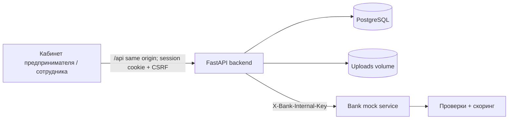
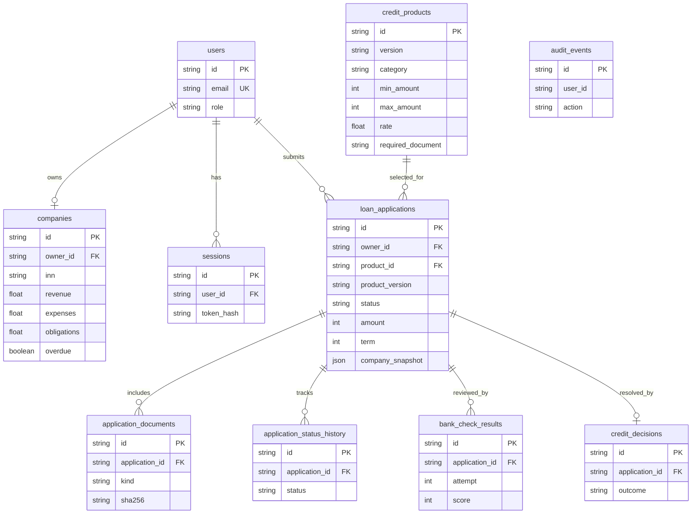

# Архитектура backend

FastAPI — модульный монолит API для предпринимателя и сотрудника банка. Vite проксирует `/api` на backend при локальной разработке; Nginx делает то же в Docker. Интерфейс получает профиль, каталог, заявки и документы из backend. Сотрудник видит отправленные заявки, результаты проверок и фиксирует решение через отдельные endpoints с проверкой роли. Сервис bank-mock отдельно развёрнут в compose-сети и не имеет опубликованного host-порта. Между сервисами используется отдельный внутренний ключ. Внешних интеграций с ФНС, БКИ и платёжными системами нет; внешний HTTPS endpoint для LLM возможен только при явной настройке и не нужен основному сценарию.

Необязательный LLM-адаптер backend вызывает OpenAI-совместимый API LM Studio на хосте, Ollama в Compose-профиле `ai` или настроенный экспертом HTTPS endpoint. Перед вызовом ассистент выбирает актуальные карточки из `credit_products` и передаёт их модели как контекст. При недоступности inference возвращается ответ по данным каталога; состояние кредитного конвейера не зависит от LLM.

## Сущности

- `users`, `sessions`: фиксированные тестовые предприниматели, хеши session-токенов, CSRF, expiry/revocation.
- `companies`: актуальный профиль компании, один профиль на пользователя.
- `credit_products`: каталог, версия условий и ограничения.
- `loan_applications`: заявка и snapshot компании/параметров продукта на момент создания.
- `application_documents`: метаданные, SHA-256 и путь файла в volume.
- `application_status_history`: append-only события жизненного цикла.
- `bank_check_results`: результаты каждой попытки синтетических проверок и скоринга.
- `credit_decisions`: outcome, причины, ставка, платёж и версия правил.
- `audit_events`: аудит ключевых действий.

## Модель данных и связи

Ключевые поля и кратности показаны ниже; точные типы и ограничения находятся в `backend/app/models/entities.py`. `loan_applications.company_snapshot` хранит JSON-снимок компании на момент создания заявки, поэтому изменение текущего профиля не переписывает уже созданную заявку. `product_version` фиксирует номер версии, но полного снимка условий продукта пока нет. Документы содержат метаданные и путь к файлу в отдельном volume.

`audit_events.user_id` и `audit_events.application_id` — сохранённые идентификаторы для аудита без ограничений внешнего ключа; связь с пользователем и заявкой здесь логическая.

## Надёжность отправки

Перед вызовом bank-mock заявка переводится в `CHECKING` и фиксируется в БД. Вызов выполняется вне транзакции БД; после ответа сохраняются проверки и результат. Если bank-mock недоступен, API возвращает 502, а заявка остаётся в `CHECKING`; повторный вызов submit разрешён. После скоринга заявка переходит в `DECISION_PENDING`, где сотрудник может одобрить, отказать или запросить сведения. Одобрение при балле ниже 50 запрещено backend-ом. При повторной отправке из `NEEDS_INFO` история и результаты предыдущих попыток сохраняются.
