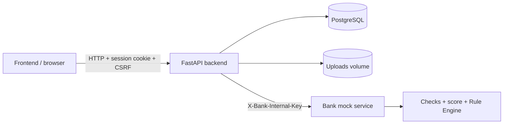

# Архитектура backend

FastAPI — модульный монолит клиентского API. Сервис bank-mock отдельно развёрнут в compose-сети и не имеет опубликованного host-порта. Между сервисами используется отдельный внутренний ключ. Внешних интеграций с ФНС, БКИ, платёжными системами или LLM нет.

## Сущности

- `users`, `sessions`: фиксированные тестовые предприниматели, хеши session-токенов, CSRF, expiry/revocation.
- `companies`: актуальный профиль компании, один профиль на пользователя.
- `credit_products`: каталог, версия условий и ограничения.
- `loan_applications`: заявка и snapshot компании/параметров продукта на момент создания.
- `application_documents`: метаданные, SHA-256 и путь файла в volume.
- `application_status_history`: append-only события жизненного цикла.
- `bank_check_results`: результаты каждой попытки синтетических проверок и скоринга.
- `credit_decisions`: outcome, причины, ставка, платёж и версия правил.
- `audit_events`: аудит ключевых действий.

## Надёжность отправки

Перед вызовом bank-mock заявка переводится в `CHECKING` и фиксируется в БД. Вызов выполняется вне транзакции БД; после ответа сохраняются проверки и результат. Если bank-mock недоступен, API возвращает 502, а заявка остаётся в `CHECKING`; повторный вызов submit разрешён. При повторной отправке из `NEEDS_INFO` история и результаты предыдущих попыток сохраняются.
